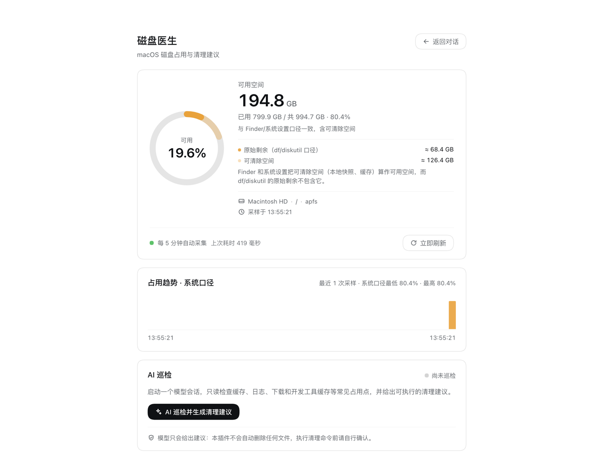

# dsh-plugins

[](https://github.com/26huitailang/dsh-plugins/actions/workflows/ci.yml)

DeepSeek Harness（DSH）插件集合。

## 界面预览

磁盘空间面板：主显示与 macOS「系统设置 → 储存空间」一致（可用空间含可清除空间），
并同时给出 `df`/`diskutil` 原始口径与可清除空间。



「立即刷新」会重新执行一次脚本化采集，并显示 `已刷新 · 采样于 HH:mm:ss` 反馈：


## 插件

### disk-doctor（磁盘医生）

macOS 磁盘空间面板 + AI 清理建议：

- **左侧栏入口**：`sidebar.panellist` 中的「磁盘医生」，打开全局主面板（`main` 槽位）。
- **脚本化周期采集（不依赖大模型）**：Host 每 5 分钟用 `df`、`diskutil` 和 JXA（NSURL 容量）只读采集，
  同时给出两套口径：
  - macOS「系统设置 / Finder」口径：可用空间（含可清除空间）与已用空间，面板主显示；
  - `df`/`diskutil` 原始口径：实际占用与原始剩余，作为补充，并显示可清除空间及差异说明。
  十进制 GB（与 macOS 一致），保留最多 288 条采样历史。
- **手动 AI 巡检（依赖大模型）**：点击「AI 巡检并生成清理建议」后，Host 创建一个真实会话并投递巡检提示词，
  模型只读巡检后给出结构化清理建议；最终回答由 Host 监听会话事件捕获并回显在面板中，可跳转完整会话。
  插件只给建议，绝不自动删除任何文件。

安装：通过 DSH Plugin Manager 以本地目录安装本仓库的 `disk-doctor/` 目录（bundle patch 自动插入 Loader 行）。
契约与设计见 [`disk-doctor/DESIGN.md`](disk-doctor/DESIGN.md)。

#### 测试

```bash
cd disk-doctor
node tests/collector.test.js   # 54 项 fixture 单测（离线、确定性）
```

CI（GitHub Actions）在 Node 18/20/22 上执行 `node --check`（全部 JS）、上述单测与
`package.json` 结构校验，见 [`.github/workflows/ci.yml`](.github/workflows/ci.yml)。

#### 界面截图

`docs/screenshots/` 中的截图由本机实测截图裁剪脱敏而来（仅保留面板区域，移除了侧栏会话列表、
菜单栏等个人界面信息）。

### neon-5cms-theme（霓虹秒速五厘米主题）

给 DSH Web UI 的「霓虹秒速五厘米 / Neon 5cm/s」第三方主题（内部 id `anime`）：深紫罗兰"夜景"
底色 + 樱花粉主色 + 淡紫次色，柔光背景、樱花发送按钮；发送消息后飘落像素樱花雨，
鼠标划过可以切开花瓣。

- **不修改任何其他包**：主题通过官方 `theme.register()` / `theme.setTheme()` 扩展点注册，
  与旧版「改写官方 theme bundle」的补丁脚本不同，DSH 升级后无需重跑脚本。
- **真正的开关**：侧栏「插件」页中该 bundle / 行的开关即启用或关闭。关闭后插件注册的主题随即
  注销，样式表与樱花雨一并移除，Host 持久化的浅色 / 深色 / 跟随系统偏好重新生效。
- **稳定 DOM 契约**：樱花按钮与樱花雨使用 `[data-composer-seat] button[aria-busy]`、
  `[data-composer-input]` 等语义属性定位，不用每次构建都会变化的 CSS Module 哈希类名。

安装：通过 DSH Plugin Manager 以本地目录安装 `neon-5cms-theme/`。
契约、开关行为与已知限制见 [`neon-5cms-theme/README.md`](neon-5cms-theme/README.md)。

#### 测试

```bash
node neon-5cms-theme/tests/contract.test.js   # 14 项离线契约测试（假 Loader / 假 ctx / 假 theme 服务）
```

## 开发辅助

- `.tools/asar.py`：只读解析 DSH 桌面版 `app.asar`，用于查看安装包内的源码/文档（`ls` / `cat` / `grep`）。
  归档路径默认为 macOS 桌面版位置，可用环境变量 `DSH_ASAR=/path/to/app.asar` 覆盖。
- `.tools/harness-host.mjs`：Host 半的 mock-Cordis 集成验证（真实 df/diskutil/JXA 命令 + 路由 + AI 会话跟踪）。

`.verify/`（本机原始实测截图）已在 `.gitignore` 中忽略，不会进入仓库；对外展示使用
`docs/screenshots/` 中的脱敏裁剪版本。

## 开源与发布说明

- 许可证：[MIT](LICENSE)。
- 两个插件的 `package.json` 目前都是本地 DSH bundle 的写法（`"private": true`、`@local/` 作用域）。
  若要发布到 npm，需要改成公开作用域/包名、移除 `private`，并补上 `repository` 字段。
- `.tools/asar.py` 默认读取 macOS 桌面版 DSH 的 `app.asar`，可用 `DSH_ASAR` 指定其他路径。

## License

[MIT](LICENSE) © 2026 26huitailang
