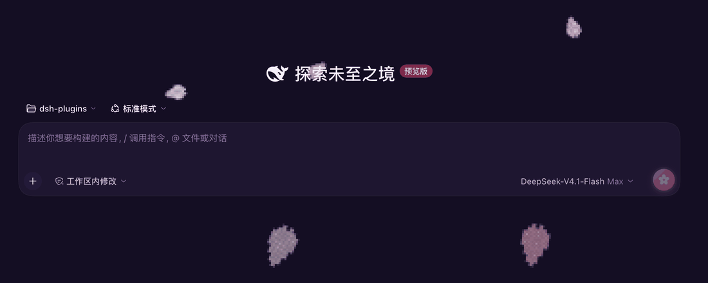

# neon-5cms-theme（霓虹秒速五厘米）

给 DSH Web UI 的「霓虹秒速五厘米」主题（内部 id：`anime`）：深紫罗兰"夜景"底色 + 樱花粉主色 +
淡紫次色，气泡、按钮、滚动条、代码块全部按樱花色系重绘，带粉色/蓝色柔光渐变，
**发送按钮是樱花风**；发送消息后背景飘落**像素樱花雨**，鼠标划过可以切开花瓣。



本包由早先的 `dsh-anime-theme` 补丁脚本迁移而来。旧脚本直接修改官方
`@deepseek-ai/dsh-client-ui-theme` 的浏览器 bundle（升级 DSH 后需要重跑脚本，且没有真正的开关）；
现在改成普通 DSH 插件：**不修改任何其他包**，通过官方主题扩展点注册，
并在「插件」页用开关启用 / 关闭。

## 开关

- **启用 / 关闭**：侧栏「插件」页 → 已安装插件中的 `@local/neon-5cms-theme`（或它的
  `neon-5cms-theme` 行）开关。关闭后本模块被卸载，插件注册的主题随之注销、样式表与樱花雨
  一并移除，Host 持久化的浅色 / 深色 / 跟随系统偏好重新生效；重新打开即在下次加载时自动激活。
- 临时切走：设置 → 外观里选「浅色 / 深色 / 跟随系统」只对当前会话生效（与旧脚本行为一致）；
  下次加载仍会激活霓虹主题。要长期回到官方主题请关闭插件开关。

## 功能

- **主题配色**：通过 `theme.register({ id: 'anime', colorScheme: 'dark', tokens })` 注册，
  `theme.setTheme('anime')` 激活；`--dsw-static-*` 色阶与 `--dsw-alias-*` 语义色整体重绘，
  默认深色观感最佳。
- **柔光背景**：紫罗兰夜景底色上叠加粉色 / 蓝色柔光渐变（`--dsw-anime-bg-glow` token +
  插件自有样式表）。
- **樱花发送按钮**：输入框右下角发送按钮改为樱花渐变 + 粉色光晕，图标换成五瓣樱花；
  hover 更亮、按下有缩放反馈；生成中的「停止」方块与发送中的 spinner 保持原图标。
- **像素樱花雨**：发送消息（点击发送按钮，或在输入框按 Enter）后，全屏飘落 9×11 像素块花瓣
  （尖端 V 形分叉、基部收窄、白色高光），1/3 分辨率 canvas 放大 + `image-rendering: pixelated`
  呈现颗粒感；缓慢下落（约 30~60 秒飘过全屏）、左右漂移、旋转、大小/深浅随机。
  **鼠标划过可切开花瓣**：花瓣沿划过方向切成两半，各自漂开、旋转、淡出，闪一道白色切光，
  被切的花瓣从顶部补新（碎片上限 250 片）。
  **AI 输出完成（发送按钮从「停止」变回发送态）后花瓣淡出自动停止**；切走主题、关闭插件或
  重载页面都会立即停止。遵循 `prefers-reduced-motion`（系统开启减少动态效果时不启动樱花雨）。
- **启动竞态处理**：等官方主题插件的设置文档就绪后再激活，并在其后 2.5 秒内重新声明一次偏好，
  避免持久化的 `light/dark/system` 在激活后把它覆盖回去（旧脚本用同样的思路解决）。

## 实现

浏览器半（`client.js`，纯 JS、无构建步骤）只用文档化的扩展点：

1. `ctx.inject(['theme'], …)` 拿到 Client `theme` 服务，`register()` / `setTheme()` 注册并激活主题，
   `ctx.on('theme/change')` 保持 `body[data-anime-theme]` 门控属性与真实激活主题一致。
2. `ctx.get('configForms').get('ui-theme')` 只读官方主题插件的设置状态（`loading → ready/unavailable`），
   作为 "设置已就绪" 信号；取不到时退化为定时器。
3. 插件自有 `<style>` 元素承载 token 表达不了的部分（柔光、樱花按钮），全部规则以
   `body[data-anime-theme]` 开头，未激活时完全惰性。
4. 樱花雨是插件自有的 `ctx.effect`：document 级 click/keydown/mousemove 监听 + 一个
   `aria-hidden` canvas；返回清理函数，关闭插件 / 热重载即销毁。

Host 半（`index.js`）只导出空 `apply()`：主题完全在浏览器端，Host 只需要 Loader 行让这个 bundle
进入组合、让 client 模块系统为浏览器提供 `client.js`。

### 稳定的 DOM 契约

樱花按钮和樱花雨需要少量 DOM 定位。这里刻意不用 CSS Module 哈希类名（官方每次构建都会重新哈希），
而用官方 UI 当前提供的语义属性：

| 选择器 | 含义 |
| --- | --- |
| `[data-composer-seat]` | 输入区容器（发送按钮的祖先） |
| `button[aria-busy]:not([aria-haspopup])` | 容器内的主发送按钮（模型选择器也带 `aria-busy`，用 `[aria-haspopup]` 排除） |
| `button[aria-busy] svg rect` | 其「停止生成」状态（生成中） |
| `button[aria-busy] svg circle` | 其「发送中」spinner 状态 |
| `[data-composer-input]` | 输入框 contenteditable（Enter 发送） |

官方 UI 改这些属性时，主题配色与柔光仍正常，只有樱花按钮 / 樱花雨会退化为无效果。

## 安装

在 DSH 的「插件」页用本地目录安装本仓库的 `neon-5cms-theme/` 目录（bundle patch 自动插入 Loader 行）：

```bash
# 或在 profile 目录手动 link（不推荐，推荐用 Plugin Manager）
# 仓库根目录的 bundle 目录结构：
#   neon-5cms-theme/{package.json, cordis.patch.yml, index.js, client.js, locale/, icon.svg}
```

安装后在「插件」页看到「霓虹秒速五厘米 / Neon 5cm/s」卡片，开关即启用 / 关闭。
热重载（HMR）会随插件文件变化自动重装，无需重启桌面端。

## 测试

```bash
node neon-5cms-theme/tests/contract.test.js
```

离线契约测试（不需要浏览器 / DOM）：用假的 `window.__ModuleLoader__` 加载 `client.js`，
用假的 Cordis ctx / theme 服务跑一遍 `apply()`，检查主题注册参数、设置就绪门控、事件订阅、
清理函数、manifest / locale / bundle patch 结构，以及 DOM 契约选择器仍在使用
（防止把旧脚本的哈希类名或补丁逻辑带回来）。

## 与旧补丁脚本的差异

| | 旧 `apply-anime-theme.sh` | 本插件 |
| --- | --- | --- |
| 实现方式 | 改写官方 theme bundle（4 处补丁） | 官方 `theme.register()` 扩展点，不碰其他包 |
| 开关 | 无（只能重跑脚本 `--undo`） | 「插件」页开关，持久化到 profile |
| DSH 升级 | bundle 被重置后需重跑脚本 | 插件随 profile 保留，无需重跑 |
| 外观设置项 | 往官方 `CUBES` 加第 4 个选项（需打补丁） | 不修改官方设置行（不改其他包是硬约束） |
| 发送按钮定位 | CSS Module 哈希类名 `.uV2eYG_primary` | `[data-composer-seat] button[aria-busy]` |
| Host 侧 | 无 | 空 `apply()`，只占 Loader 行 |

## 配色速览

| 用途 | 颜色 |
|------|------|
| 背景 / 层级 | `#150e24` / `#1a122b` / `#1f1632` / `#251a3b`（紫罗兰夜景） |
| 主色 / 按钮 / 品牌 | `#ff6a9f`（樱花粉）→ hover `#ff85b4` |
| 用户气泡 | `#3a2138`（暗樱花） |
| 次级文字 | `#c2ade0` / `#a58bcc`（淡紫） |
| 强调蓝（链接等） | `#5b84f2` 系 |
| 滚动条 | 紫灰阶 `#372754` → `#6f569e` |

## 已知限制

- 官方设置页「外观」行只有 浅色 / 深色 / 跟随系统 三项（那是官方插件的静态数组）。本插件不改它，
  所以激活时四项都会显示未选中；切走官方主题只在本次会话生效，长期关闭请用插件开关。
- 樱花按钮 / 樱花雨依赖上表的语义属性；官方 UI 若改动这些属性，二者会静默失效（主题本身不受影响）。
- 模型选择器按钮同样带 `aria-busy`，选择器用 `:not([aria-haspopup])` 把它排除；若官方给它去掉
  `aria-haspopup`，它会被重新当成发送按钮（主题色仍正常，只是该按钮会变成樱花样式）。
- `dsh-anime-theme` 的原始脚本与备份留在原笔记目录，未纳入本仓库。

## License

[MIT](../LICENSE) © 2026 26huitailang
